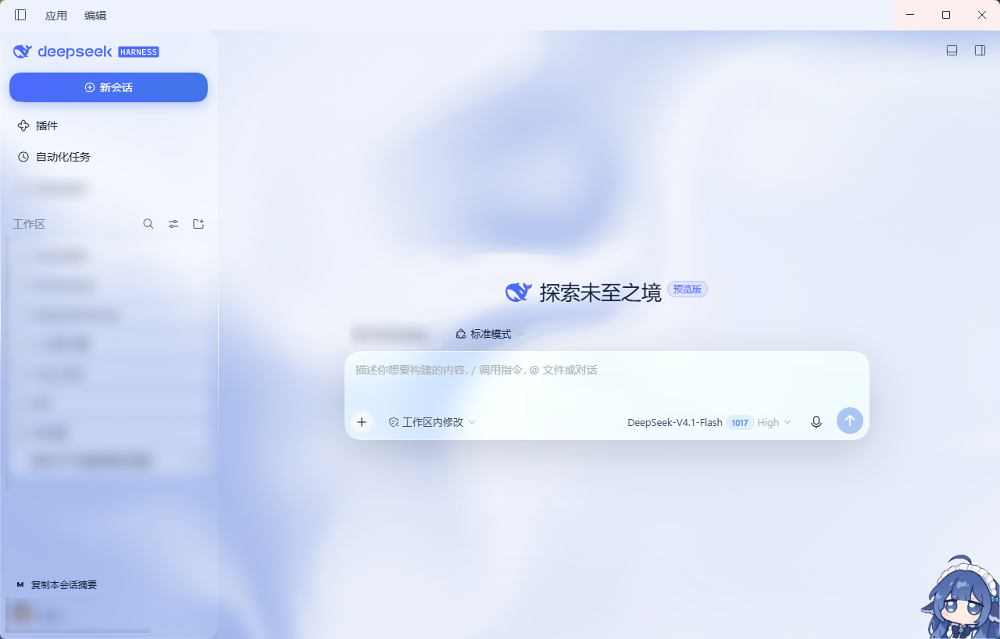
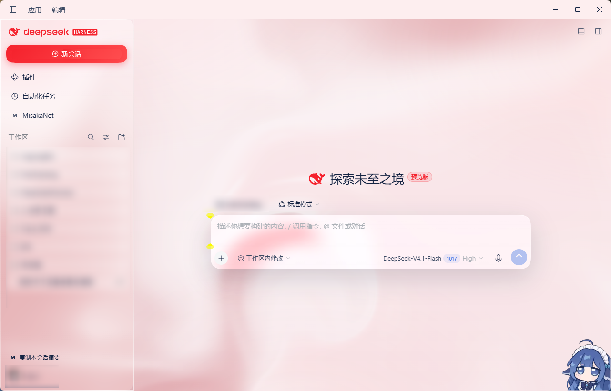
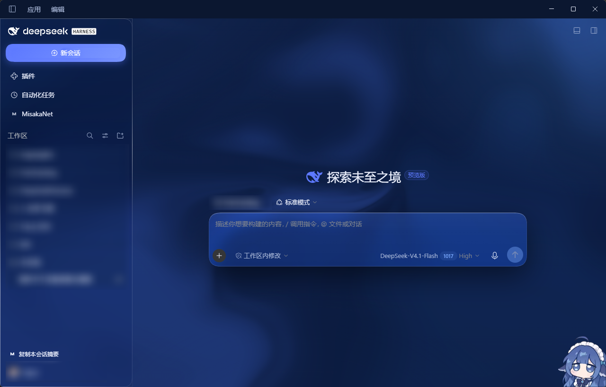

# DeepSeek Style Theme

 |  |  |

## 安装方式

为 **DeepSeek Harness** 复刻 DeepSeek 官网视觉的主题皮肤插件，主要为Desktop端适配。

### 从官方插件系统安装：

DeepSeekHarness Desktop端：插件 - 添加插件 - 粘贴
```
deepseek-style-theme
```
即可安装
### 从 npm（推荐）

```bash
dsh plugin --profile web add dsh-deepseek-style-theme
```

## 特性

- **流体流动背景**
- **液态玻璃**
- **鼠标跟随的对话窗光斑**（dsh-theme-mineradio）
- **玻璃拟态**
- **明暗双主题**
- **DeepSeek官网链接**（桌面端已废弃）
- **运行中子代理面板**（老版本比较好用，未来可能会更新）
- **交付文件菜单（未来会废弃）**
- **时段提示（DSTT）**：主题模式四选一——**峰谷红蓝**（高峰鲜红、谷时段蓝）/ **峰谷红绿**（高峰鲜红、谷时段绿）/ **常态绿** / **常态蓝**；高峰窗口北京时间 9:00–12:00、14:00–18:00（周六周日全天非高峰），高峰色为鲜红 `#F5222D`

### 高峰判定（1.37.0+）

- 固定按**北京时间（UTC+8）**判断；**向上取整到整分钟**（13:59:xx 视为 14:00）。
- 高峰窗口：9:00–12:00、14:00–18:00（**周六、周日全天非高峰**）。
- 峰谷模式下高峰自动变鲜红，退出高峰自动还原。

## 必要权限

- **安装期**
- **运行时（DSH 审批/沙箱）**：**不需要任何额外权限**——不注册工具、不执行模型调用、不请求审批或沙箱提升。它只是纯前端皮肤 + 一个受限 RPC 通道。
- **出网动作：**无2.1.90 起本插件不发起任何外部请求
- **系统级副作用**：交付文件卡片的操作菜单有四个动作。「打开文件」与「打开所在文件夹」**优先走官方通路** `session.openWorkspacePath({ path })` / `({ path, action: 'reveal' })` —— 宿主侧自己校验路径、解析工作区映射，拿不到已验证映射时抛错而不是猜。「复制路径」纯前端写剪贴板，不经过宿主端。只有在官方这条远程不存在时（旧内核），前两者才回落到本插件自己的私有通道 `dshome/file.open`（Windows `Start-Process`、macOS `open`、Linux `xdg-open`）与 `dshome/file.reveal`（Windows `explorer /select`、macOS `open -R`、Linux 打开所在目录），那条通道同样只接受本机绝对路径、走同一套围栏。**「打开工作区目录」已在 2.1.90 移除**：那个手势改用官方的 open-in-app，本插件不再自己开文件管理器。
- **私有 RPC 通道的围栏**（1.41.0 起与 dsh 核心 `/api` 同一套判定）：只接受
  1. **回环对端**（`127.0.0.1` / `::1`）——该通道一直如此；
  2. `Host` 为回环权威（`127.x` / `[::1]` / `localhost`），挡掉 DNS rebinding；
  3. `Sec-Fetch-Site` 非 `cross-site`，且 `Origin` 存在时必须与 `Host` 同源——挡掉跨站 `fetch`（简单请求不触发预检，副作用仍会执行）；
  4. `Content-Type: application/json`——让跨站尝试必须预检，而本路由从不回应预检；
  5. `payload.path` 必须是**本机绝对路径**：相对路径、含 NUL、UNC（`\\host\share`、`//host/share`）一律拒绝。UNC 会让 Windows 向该主机做认证，可被用来外带 NTLM 哈希。
- **数据可见性**：客户端读取会话列表元数据（标题、运行状态、token 用量）仅用于页内展示「运行中子代理」面板，不上传任何外部服务器；唯一的网络跳转是点击品牌标识时打开 `deepseek.com`（显式用户操作）。宿主端的唯一请求是上一条所述的 `GET {baseURL}/models`，只发往你配置的 DeepSeek 端点，不携带会话内容。
- **桌面壁纸（2.0.75+，只在显式选择时触发）**：预留，未适配

## 卸载

```bash
dsh plugin --profile web remove dsh-deepseek-style-theme
```
- 该命令移除依赖并自动从 `dsh.profile.bundles` 装配列表剔除，重启 `dsh web` 后主题完全消失。

## 目录结构

```
.
├── package.json                    # dsh bundle 元数据
├── cordis.patch.yml                # insert 插件行
├── THIRD-PARTY-NOTICES.md          # 第三方许可原文（mineradio / harness-background）
├── releases/                       # 发布产物（tgz 归档）
├── tools/                          # 自测工具（不随包发布）
│   ├── bridge-smoke.mjs            # 宿主端私有 RPC 通道冒烟测试
│   ├── symptom-probe.js            # 贴进控制台的现场探针（环境报告 + 采样 + 逐帧 diff + 开关）
│   ├── symptom-probe-selftest.mjs  # 上面那份探针的自测（合成页面 + CDP 真实鼠标）
│   └── gui-probe.mjs               # 实时页面的无头浏览器探测与像素扫描
└── lib/
├── index.js                    # host 端：交付文件 RPC、DSTT 设置、桌面壁纸
    └── client.js                   # 主题 client 端（含流体背景、液态玻璃、交付文件卡片菜单）
```

## 许可

MIT

### 鸣谢

[dsh-theme-mineradio](https://github.com/dhicoc/dsh-theme-mineradio) v2.3.8
[deepseek-harness-background](https://github.com/HaoyueQin/deepseek-harness-background) 

> 本插件为第三方主题皮肤，复刻 DeepSeek 官网视觉风格，与 DeepSeek（深度求索）官方无隶属关系、无背书或关联；DeepSeek 为深度求索公司的商标。
